# 🛍️ Mall Shopper Profiling

### Segmenting 200 mall customers into shopper personas with unsupervised learning


## 🎥 Project Explanation Video

[](YOUR_GOOGLE_DRIVE_LINK_HERE)

👉 **Video link:** https://drive.google.com/file/d/1rBpyqneQIENbdkn9_dPXoYPRnApASQCl/view?usp=sharing

> 🚧 Video coming soon. A full walkthrough of the data, models, results and business insights.

---

## 📌 Overview

A mall wants to know **who its shoppers really are**. This project clusters 200 customers by income and spending behaviour using **K-Means**, **Agglomerative (Hierarchical) Clustering** and **DBSCAN**, compares them, and turns the result into **5 actionable personas** with marketing strategies. 🎯

**Final pick: K-Means (k = 5)** ✅ stable, covers every customer, matches the 5 groups visible in the raw data.

---

## 📂 Project Structure

```
Mall_Shopper_Profiling/
├── 📁 dataset/
│   └── Mall_Customers.csv
├── 📁 notebooks/
│   └── MallShopperSegmentation_UnsupervisedLearning.ipynb
├── 📁 visuals/            # 20 saved charts
├── 📁 model/
│   ├── mall_scaler.pkl
│   └── mall_segmentation_model.pkl
└── 📄 README.md
```

---

## 🗃️ Dataset

| Column | Description |
|---|---|
| `CustomerID` | Unique ID |
| `Gender` | Female / Male (112 / 88) |
| `Age` | Customer age |
| `Annual Income (k$)` | Yearly income in thousands |
| `Spending Score (1-100)` | Mall-assigned spending score |

📏 200 rows · 5 columns · **0 missing values**

---

## 🔄 Workflow

1. 🔍 **EDA** – distributions, outliers, bivariate analysis, gender summary
2. 🛠️ **Feature engineering** – gender encoding, income / age / spending groups, `StandardScaler`
3. 🎯 **K-Means** – elbow + silhouette, 2D vs 5D feature sets, persona profiling
4. 🌳 **Hierarchical** – Ward dendrogram, linkage comparison
5. 🧩 **DBSCAN** – k-NN distance plot, eps / min_samples grid search
6. ⚖️ **Comparison** – Silhouette, Davies-Bouldin, Calinski-Harabasz, stability test
7. 🚀 **Deployment** – saved model + `classify_shopper()` function for new customers

---

## 📊 1. Exploratory Data Analysis

### 📈 Univariate analysis

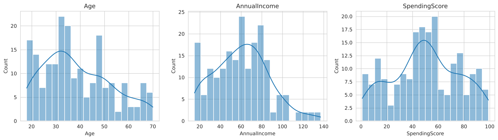

- Age is slightly right-skewed, most customers are 20-50.
- Income is roughly bell-shaped around 60k.
- Spending score spans the full range.

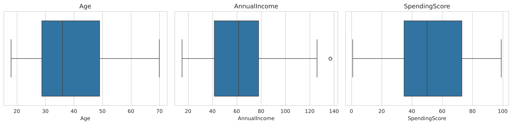

Only **AnnualIncome** has outliers (2 customers near 137k). They are genuine, so they are kept.

### 🚻 Gender

| Gender count | Gender averages |
|:---:|:---:|
| 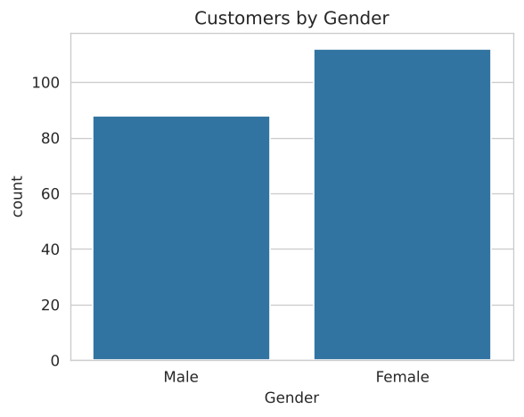 | 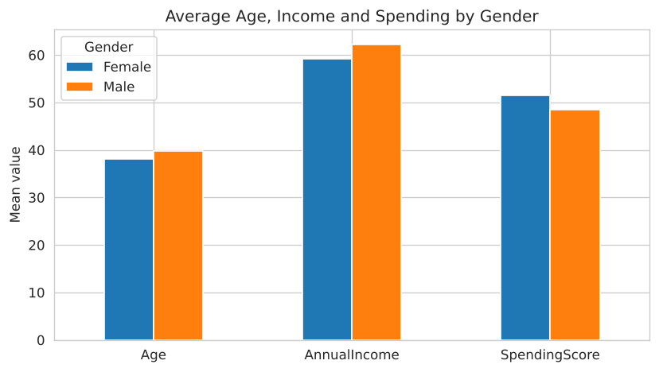 |

Women score slightly higher on spending (51.5 vs 48.5). Men earn slightly more (62.2k vs 59.3k). Differences are small, so gender alone is a weak segmentation basis.

### 🔗 Bivariate analysis

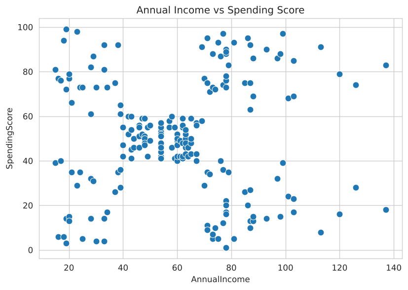

👀 **Five natural groups are visible before any algorithm runs.**

| Age vs Spending | Age vs Income |
|:---:|:---:|
| 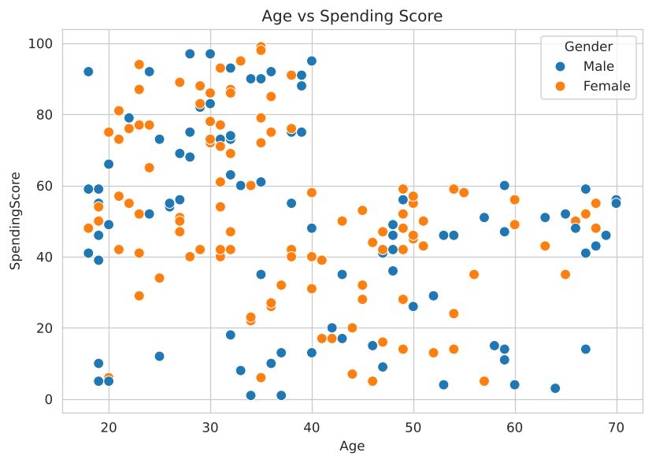 | 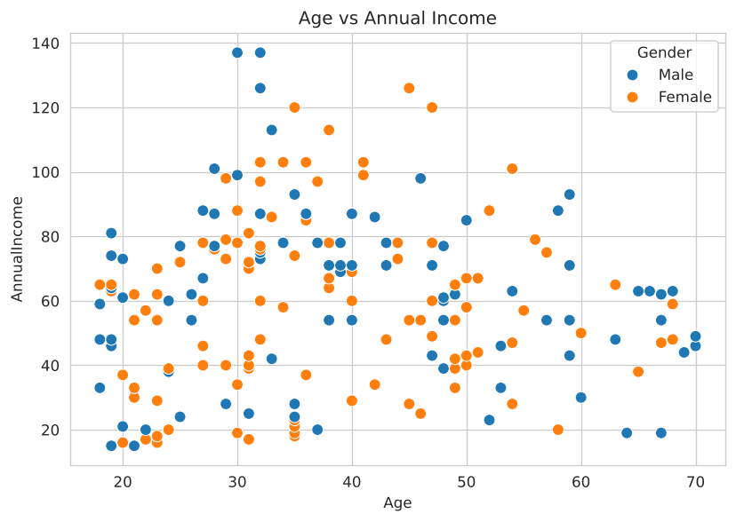 |

### 🌡️ Correlation

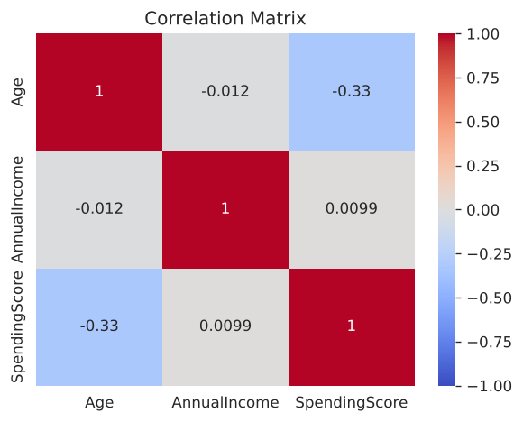

| Pair | Correlation |
|---|---|
| Age ↔ SpendingScore | **-0.327** (younger spend more) |
| Age ↔ AnnualIncome | -0.012 |
| AnnualIncome ↔ SpendingScore | 0.010 |

---

## 🎯 2. K-Means Clustering

### 📐 Choosing k

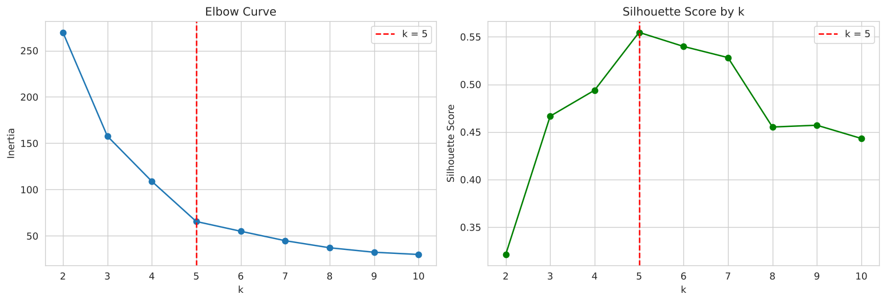

| k | Inertia | Silhouette |
|:-:|:-:|:-:|
| 2 | 269.69 | 0.321 |
| 3 | 157.70 | 0.467 |
| 4 | 108.92 | 0.494 |
| **5** | **65.57** | **0.555** ⭐ |
| 6 | 55.06 | 0.540 |
| 7 | 44.87 | 0.528 |

✅ Elbow bends at **k = 5** and silhouette peaks there.

### 🗺️ Cluster plots (2D: Income + Spending)

| Income vs Spending | Age vs Spending |
|:---:|:---:|
| 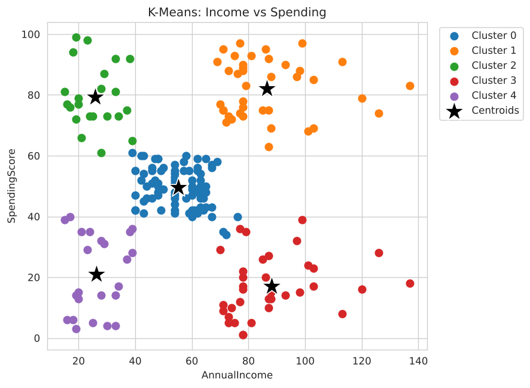 | 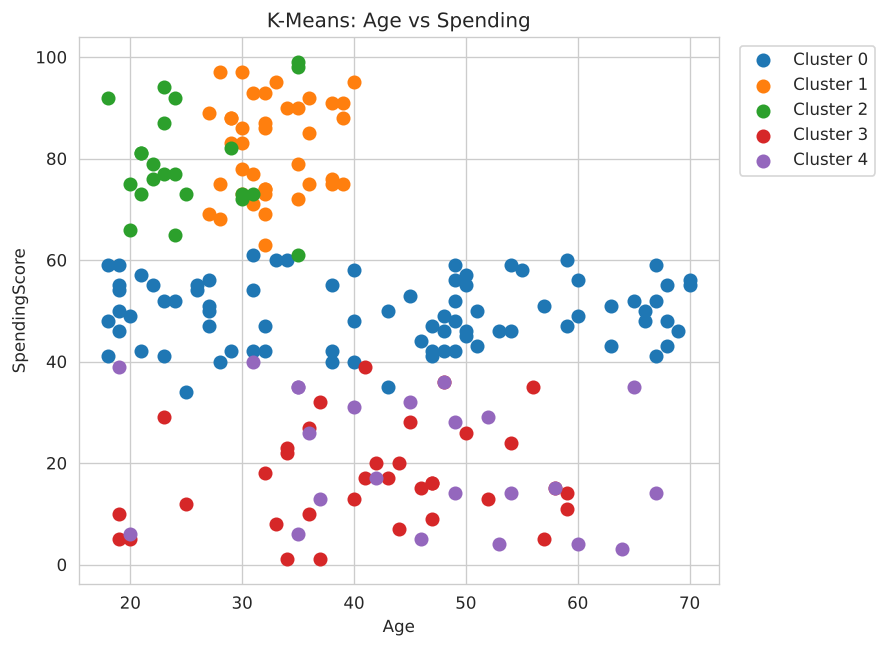 |

### 🧪 2D vs 5D features

| Feature set | Silhouette |
|---|:-:|
| 2D (Income, Spending) | **0.5547** ✅ |
| 5D (+ Age, Gender) | 0.3144 |

Adding Age and Gender blurs cluster boundaries, so the **2D model wins**.

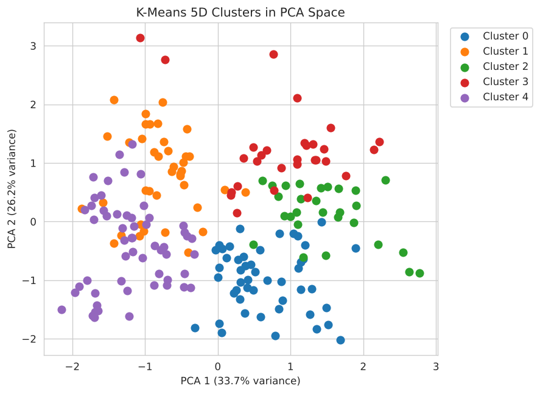

### 👥 Personas

| Persona | Customers | Avg Age | Income (k$) | Spending |
|---|:-:|:-:|:-:|:-:|
| 💎 Big Spenders | 39 | 32.7 | 86.5 | 82.1 |
| 🌟 Young Aspirers | 22 | 25.3 | 25.7 | 79.4 |
| 🛒 Average Shoppers | 81 | 42.7 | 55.3 | 49.5 |
| 🏷️ Budget Shoppers | 23 | 45.2 | 26.3 | 20.9 |
| 🧐 Careful Spenders | 35 | 41.1 | 88.2 | 17.1 |

---

## 🌳 3. Agglomerative Hierarchical Clustering

| Full dendrogram | Truncated dendrogram (cut at 6.9) |
|:---:|:---:|
| 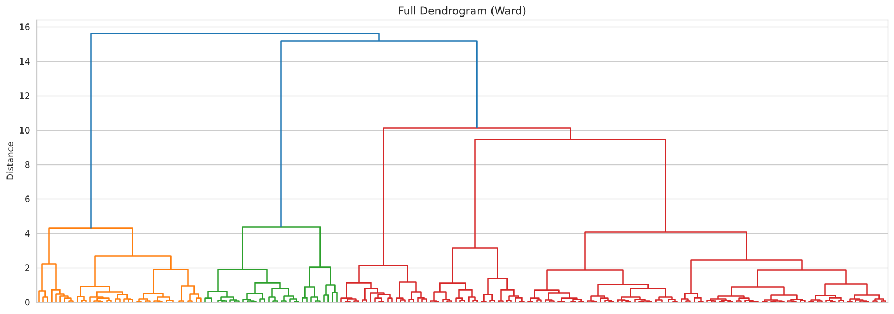 | 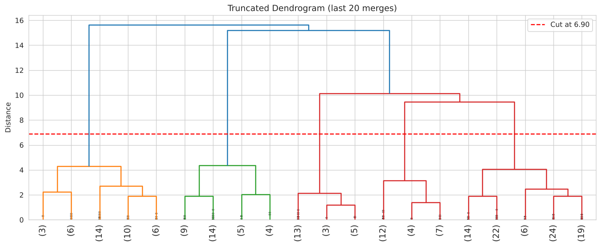 |

The cut sits in the longest vertical gap and gives **5 clusters**.

| Linkage | Silhouette |
|---|:-:|
| **Ward** ✅ | **0.5538** |
| Complete | 0.5531 |
| Average | 0.4794 |

| Income vs Spending | Age vs Spending |
|:---:|:---:|
| 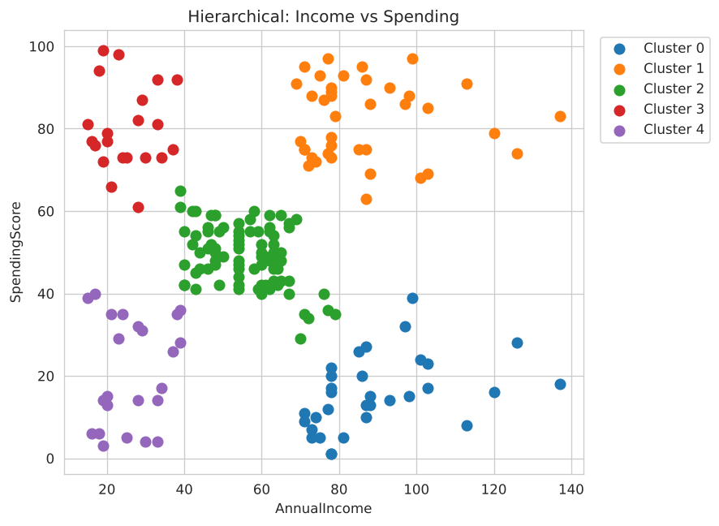 | 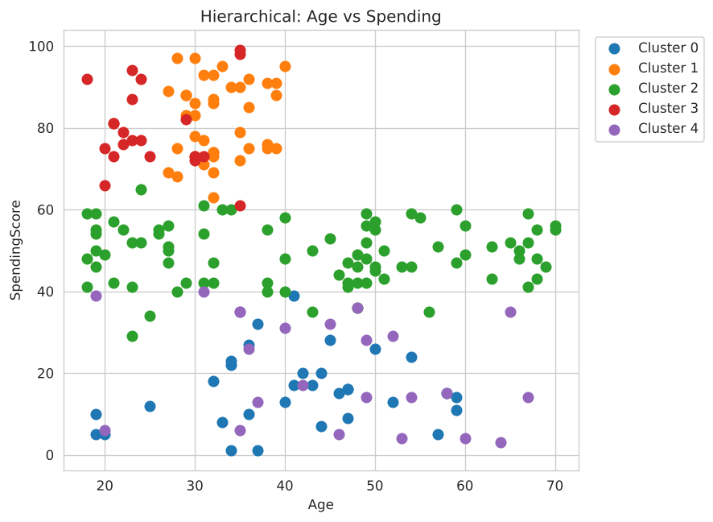 |

🤝 **98.0% agreement** with K-Means. Same five personas.

---

## 🧩 4. DBSCAN

### 📏 Choosing eps

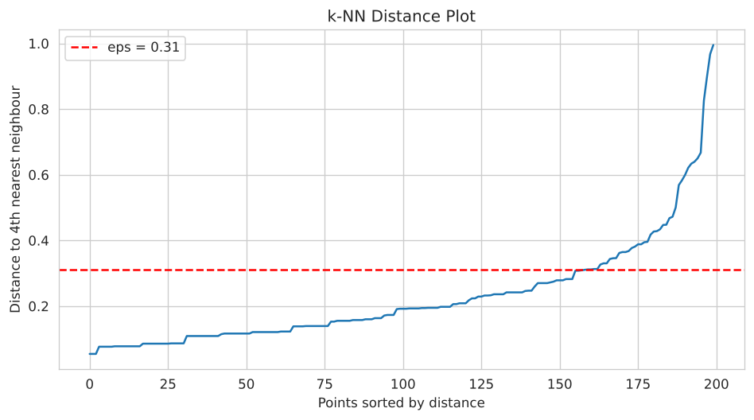

Knee at **eps ≈ 0.31**.

### 🔥 Grid search (eps × min_samples)

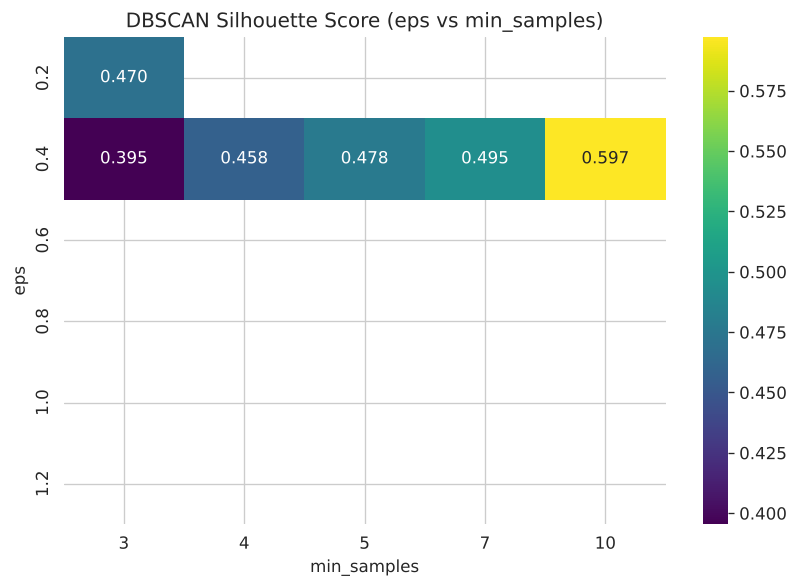

Best silhouette: **eps = 0.4, min_samples = 10** → 4 clusters, **25.5% noise (51 customers)**.

### 🗺️ Cluster plots

| Income vs Spending | Age vs Spending |
|:---:|:---:|
| 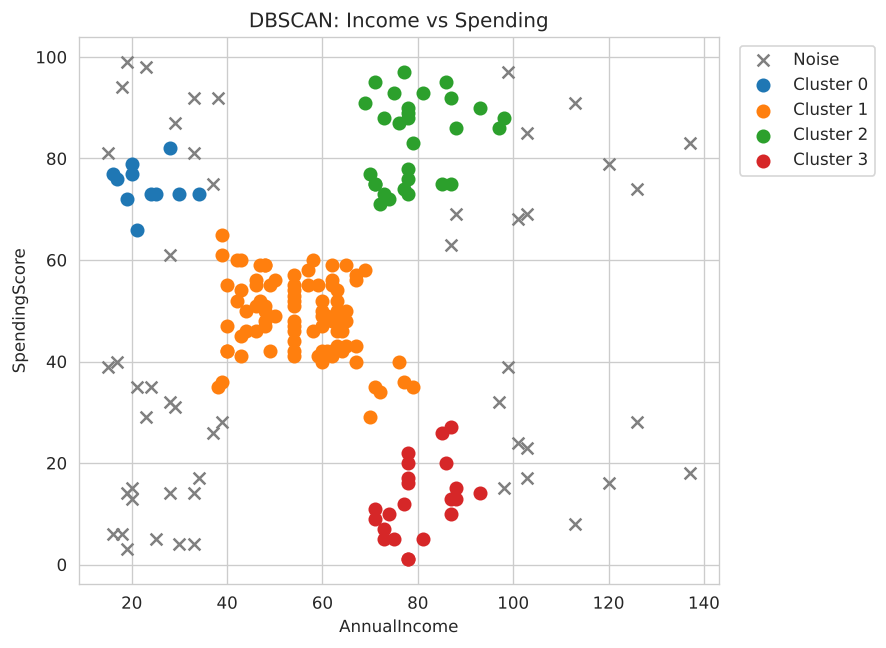 | 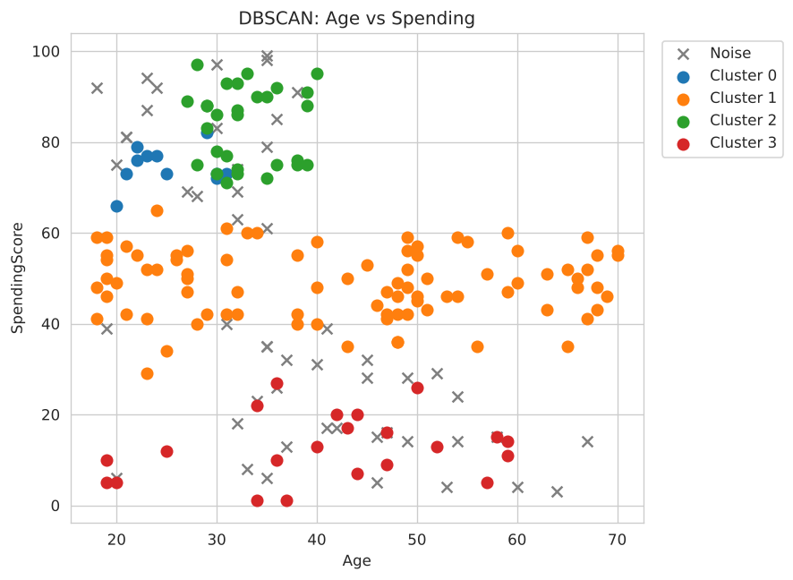 |

⚠️ The **Budget Shoppers** group is lost to noise.

---

## ⚖️ 5. Algorithm Comparison

| Algorithm | Clusters | Silhouette | Davies-Bouldin | Calinski-Harabasz | Noise % |
|---|:-:|:-:|:-:|:-:|:-:|
| **K-Means** ✅ | 5 | 0.555 | 0.572 | 248.6 | 0% |
| Agglomerative (Ward) | 5 | 0.554 | 0.578 | 244.4 | 0% |
| DBSCAN | 4 | 0.597 | 0.473 | 263.6 | 25.5% |

🧠 DBSCAN looks best on paper, but its metrics are computed on only 74.5% of customers and one persona vanishes. **K-Means gives the most useful, complete segmentation.**

🔁 **Stability:** silhouette = 0.5547 across 5 random seeds (std = 0.000000).

---

## 💼 6. Business Recommendations

| Segment | Customers | Strategy |
|---|:-:|---|
| 💎 Big Spenders | 39 | Premium lounge, luxury pop-ups near the food court, early access to new collections |
| 🧐 Careful Spenders | 35 | Invite-only events, personalised offers on quality brands |
| 🛒 Average Shoppers | 81 | Mid-market anchor stores, seasonal sales, loyalty points |
| 🌟 Young Aspirers | 22 | Trend / fast-fashion zones, student discounts, social contests |
| 🏷️ Budget Shoppers | 23 | Value stores near entrances, ₹50-off coupons via mall app |

📌 **Data that would improve this:** basket value, visit frequency / dwell time, loyalty app behaviour, customer postcode.

---

## 🚀 7. Deployment

The trained scaler and K-Means model are saved with `joblib` and wrapped in a helper:

```python
import joblib
import pandas as pd

scaler = joblib.load('model/mall_scaler.pkl')
model = joblib.load('model/mall_segmentation_model.pkl')

def classify_shopper(annual_income, spending_score):
    point = scaler.transform(pd.DataFrame([[annual_income, spending_score]],
                                          columns=['AnnualIncome', 'SpendingScore']))
    return int(model.predict(point)[0])
```

| Age | Income (k$) | Spending | Persona |
|:-:|:-:|:-:|---|
| 22 | 30 | 85 | 🌟 Young Aspirers |
| 45 | 95 | 15 | 🧐 Careful Spenders |
| 31 | 88 | 90 | 💎 Big Spenders |
| 58 | 20 | 10 | 🏷️ Budget Shoppers |
| 35 | 55 | 50 | 🛒 Average Shoppers |

> ℹ️ The saved model uses income and spending score only. Age and gender do not affect the result.

---

## ⚙️ Getting Started

```bash
# 1. Clone
git clone https://github.com/<your-username>/Mall_Shopper_Profiling.git
cd Mall_Shopper_Profiling

# 2. Install
pip install numpy pandas matplotlib seaborn scipy scikit-learn joblib jupyter

# 3. Run
jupyter notebook notebooks/MallShopperSegmentation_UnsupervisedLearning.ipynb
```

> 📝 The notebook reads `../dataset/` and writes to `../visuals/` and `../model/`, so run it from inside the `notebooks/` folder.

---

## 🧰 Tech Stack

`Python` · `Pandas` · `NumPy` · `Matplotlib` · `Seaborn` · `SciPy` · `scikit-learn` · `joblib` · `Jupyter`

---

## 🙌 Author

**Mr Om** · Data Analyst 📊

⭐ If this helped, drop a star on the repo!
